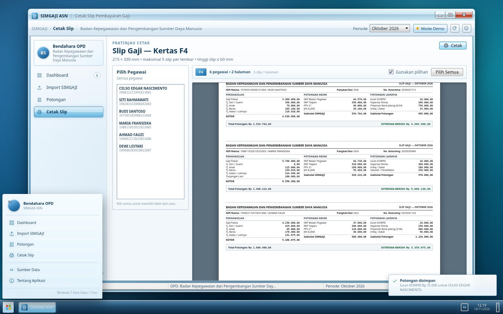
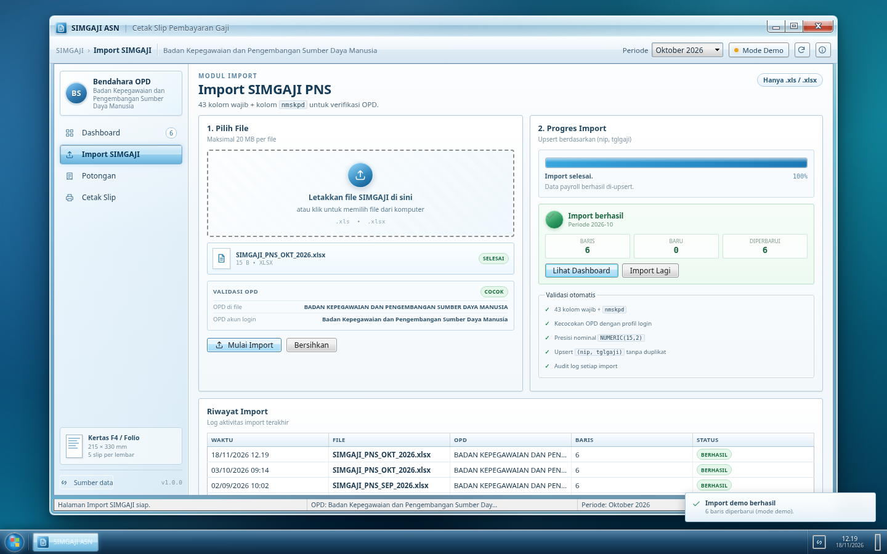
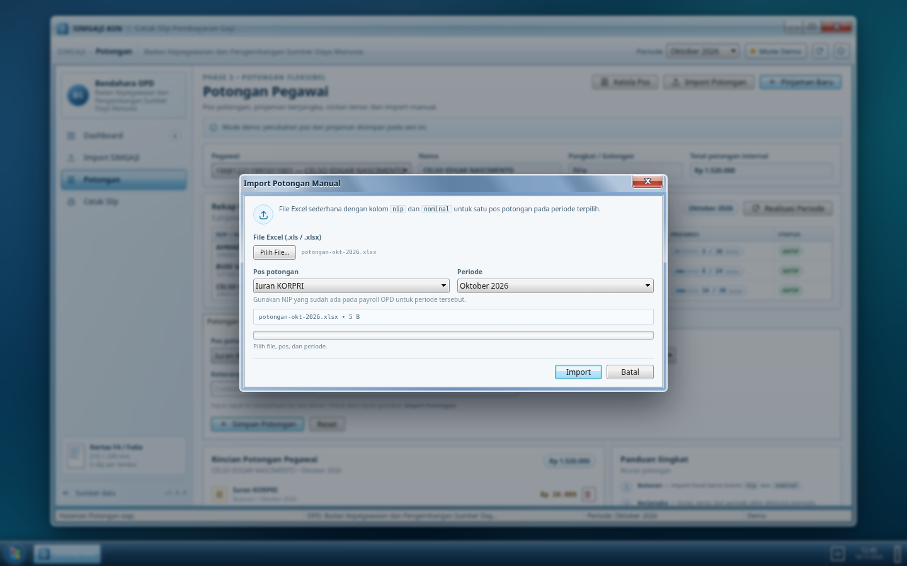
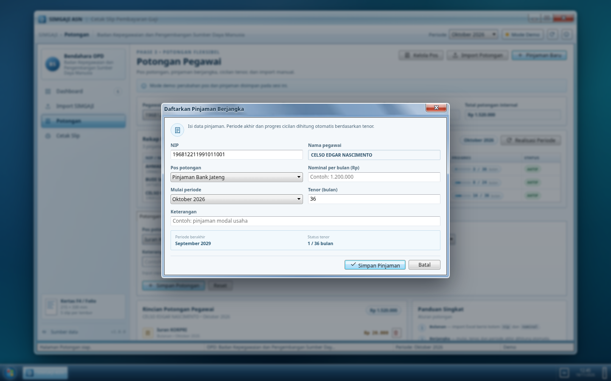
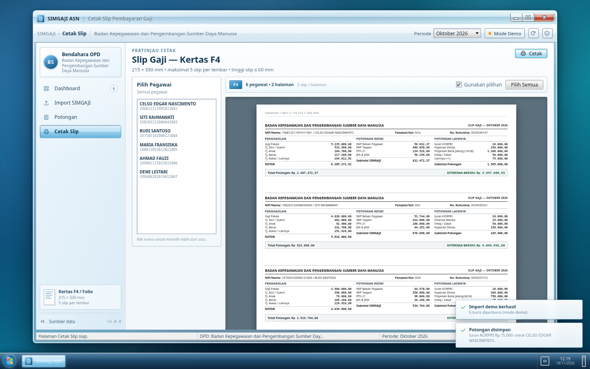

# Panduan Pengguna (User Guide)
## Aplikasi Penggajian dan Cetak Slip Gaji ASN Pemerintah Daerah

Dokumen ini berisi panduan operasional komprehensif untuk **Bendahara OPD** dan **Super Admin** dalam menggunakan Aplikasi Penggajian dan Cetak Slip Gaji ASN berbasis FastAPI, PostgreSQL, Firebase Authentication, dan antarmuka klasik Windows 7 Aero Glass.

---

## Daftar Isi
1. [Prinsip & Keamanan Utama](#prinsip--keamanan-utama)
2. [Panduan Operasional Bendahara OPD](#bagian-1-panduan-operasional-bendahara-opd)
   - 2.1. [Login Akun Google & Penetapan OPD Awal](#21-login-akun-google--penetapan-opd-awal)
   - 2.2. [Impor File Payroll SIMGAJI PNS (.xls / .xlsx)](#22-impor-file-payroll-simgaji-pns-xls--xlsx)
   - 2.3. [Mengatasi Error Validasi & Isolasi OPD](#23-mengatasi-error-validasi--isolasi-opd)
   - 2.4. [Manajemen Potongan Tambahan Bulanan](#24-manajemen-potongan-tambahan-bulanan)
   - 2.5. [Pendaftaran Pinjaman Berjangka (Tenor)](#25-pendaftaran-pinjaman-berjangka-tenor)
   - 2.6. [Pencetakan Slip Gaji Kertas F4 (Single & Kolektif)](#26-pencetakan-slip-gaji-kertas-f4-single--kolektif)
3. [Panduan Operasional Super Admin](#bagian-2-panduan-operasional-super-admin)
   - 3.1. [Hak Istimewa Super Admin (`teguhe@gmail.com`)](#31-hak-istimewa-super-admin-teguhegmailcom)
   - 3.2. [Pemantauan Log Aktivitas & Audit Trail](#32-pemantauan-log-aktivitas--audit-trail)
   - 3.3. [Reset & Pengalihan OPD Bendahara](#33-reset--pengalihan-opd-bendahara)
   - 3.4. [Manajemen Master Pos Potongan Lintas OPD](#34-manajemen-master-pos-potongan-lintas-opd)
4. [Tanya Jawab & Pemecahan Masalah (FAQ)](#tanya-jawab--pemecahan-masalah-faq)

---

## Prinsip & Keamanan Utama
1. **Isolasi Data OPD Ketat:** Setiap bendahara hanya berhak mengelola data pegawai yang berada dalam naungan OPD-nya (`ref_opd.nmskpd`). Data pegawai instansi lain tidak akan pernah tampil.
2. **Presisi Finansial Mutlak:** Seluruh kalkulasi nominal uang menggunakan representasi desimal fixed-point `NUMERIC(15,2)` / `Decimal` (bebas pembulatan floating-point liar).
3. **Standar Cetak F4 Pemerintah Daerah:** Output slip dirancang khusus untuk kertas Folio/F4 ($215\,\text{mm} \times 330\,\text{mm}$) dengan tata letak padat 4 hingga 5 slip per lembar (tinggi $\le 60\,\text{mm}$).

---

## Bagian 1: Panduan Operasional Bendahara OPD

### 2.1. Login Akun Google & Penetapan OPD Awal
1. Buka aplikasi pada peramban web modern (Google Chrome, Microsoft Edge, atau Mozilla Firefox).
2. Klik tombol **Sign in with Google** atau gunakan Start Orb di pojok kiri bawah $\rightarrow$ **Akun & Profil**.
3. Masuk dengan akun Google resmi kedinasan Anda.
4. **Penetapan OPD Pertama Kali (Onboarding):**
   - Jika akun Anda baru pertama kali masuk dan belum memiliki OPD tertaut, sistem akan otomatis menampilkan dialog **Pilih Unit Kerja / OPD**.
   - Pilih nama Organisasi Perangkat Daerah Anda dari daftar dropdown yang tersedia.
   - **Perhatian Penting:** Pastikan nama OPD yang Anda pilih **persis sama** dengan header teks pada kolom `nmskpd` di file Excel SIMGAJI instansi Anda.
   - Klik **Simpan & Tetapkan OPD**.
   - Status bar di pojok kanan bawah desktop Aero akan menampilkan nama OPD dan email aktif Anda.



---

### 2.2. Impor File Payroll SIMGAJI PNS (.xls / .xlsx)
Setiap awal bulan setelah berkas daftar gaji induk diterbitkan oleh BPKAD / SIMGAJI, bendahara mengunggah file tersebut ke dalam sistem:

1. Buka jendela **Impor SIMGAJI** melalui ikon desktop atau Start Menu $\rightarrow$ *Impor Data Gaji*.
2. Tarik dan lepas (*drag & drop*) file Excel SIMGAJI (`.xls` atau `.xlsx`) ke dalam area dropzone, atau klik tombol **Pilih Berkas Excel**.
3. Sistem secara otomatis membaca file dan memverifikasi prasyarat:
   - Validasi keberadaan 43 kolom wajib + kolom `nmskpd`.
   - Validasi kesesuaian OPD file terhadap profil OPD bendahara login.
   - Pengecekan duplikasi `(nip, tglgaji)`.
4. Klik tombol **Proses Impor Payroll**.
5. Sistem akan menampilkan progress bar dan dialog hasil impor:
   - **Total Baris:** Jumlah data pegawai yang diproses.
   - **Inserted:** Jumlah data baru yang berhasil dimasukkan.
   - **Updated:** Jumlah data yang diperbarui (karena NIP & periode sama diunggah ulang).
   - **Periode:** Periode penggajian yang terdeteksi (contoh: `2026-10`).



> [!NOTE]
> **Mekanisme Anti-Duplikasi (Idempotensi):**
> Mengunggah file SIMGAJI yang sama berulang kali **tidak akan menggandakan data**. Sistem menggunakan constraint basis data `(nip, tglgaji)` untuk memperbarui nilai (*upsert* / `ON CONFLICT DO UPDATE`), sehingga nominal gaji selalu mutakhir.

---

### 2.3. Mengatasi Error Validasi & Isolasi OPD
Jika proses impor ditolak, periksa pesan galat yang tampil di layar:

* **Error: `OPD pada file (...) tidak cocok dengan profil OPD Anda (...)`**
  * **Penyebab:** Kolom `nmskpd` di dalam Excel memuat nama instansi lain, atau terdapat perbedaan penulisan spasi/singkatan nama dinas.
  * **Solusi:** Pastikan Anda mengunggah file gaji OPD Anda sendiri. Jika nama OPD di sistem salah sejak awal registrasi, hubungi Super Admin untuk melakukan reset OPD.
* **Error: `Kolom wajib tidak ditemukan di Excel: ...`**
  * **Penyebab:** Format ekspor SIMGAJI terpotong atau baris header diubah.
  * **Solusi:** Pastikan mengekspor langsung file standar SIMGAJI tanpa menghapus 43 kolom default (`tglgaji`, `nip`, `nama`, `gapok`, ..., `bersih`).
* **Error: `Format file harus .xls atau .xlsx`**
  * **Solusi:** Simpan berkas ke format Microsoft Excel Workbook (`.xlsx`) atau Excel 97-2003 (`.xls`). Jangan mengunggah file `.csv` atau `.pdf`.

---

### 2.4. Manajemen Potongan Tambahan Bulanan
Selain potongan resmi SIMGAJI (IWP, Taspen, Pajak, dll.), bendahara dapat mencatat potongan internal seperti Iuran KORPRI, Dharma Wanita, Infaq/Zakat, dan Koperasi Dimas.

#### A. Input Cepat Perorangan:
1. Masuk ke tab jendela **Potongan Tambahan**.
2. Pilih pegawai dari tabel daftar ASN di sisi kiri.
3. Pada panel kanan **Potongan Bulanan Cepat**:
   - Pilih **Pos Potongan** (contoh: *Iuran KORPRI*).
   - Masukkan **Nominal (Rp)** (contoh: `20.000`).
   - Masukkan keterangan jika perlu.
   - Klik **Simpan Potongan**.
4. Rincian potongan internal langsung diperbarui secara realtime dan menghitung ulang *Take Home Pay*.

#### B. Impor Massal Potongan Manual via Excel (NIP & Nominal):
Untuk pos iuran seragam dengan nominal variatif (contoh: Baznas, Bazar Koperasi), gunakan fitur impor massal:
1. Di jendela **Potongan Tambahan**, klik tombol **Impor Potongan via Excel**.
2. Pilih **Pos Potongan Bulanan** target.
3. Pilih **Periode Payroll** (contoh: `2026-10`).
4. Siapkan file Excel dengan 2 kolom wajib:
   - `nip`: NIP ASN (contoh: `196812211991011001`).
   - `nominal`: Nominal potongan angka (contoh: `25000` atau `25.000`).
5. Unggah file dan klik **Proses Impor**.
6. Sistem memverifikasi seluruh NIP terdaftar di OPD pada periode tersebut dan melakukan upsert atomik.



---

### 2.5. Pendaftaran Pinjaman Berjangka (Tenor)
Untuk potongan berangsur seperti pinjaman Bank Jateng, BPD, atau kredit koperasi, Anda hanya perlu menginput sekali:

1. Di jendela **Potongan Tambahan**, klik tombol **Daftar Pinjaman Baru**.
2. Isi formulir data pinjaman:
   - **Pegawai (NIP/Nama):** Pilih atau ketik NIP/Nama pegawai.
   - **Pos Potongan:** Pilih pos pinjaman (kategori berjangka).
   - **Nominal per Bulan (Rp):** Contoh `1.200.000`.
   - **Bulan Mulai (Start Period):** Contoh `2027-01` (Januari 2027).
   - **Durasi Tenor (Bulan):** Contoh `36`.
   - **Bulan Selesai (End Period):** Otomatis dihitung oleh sistem $\rightarrow$ `2029-12` (Desember 2029).
   - **Keterangan:** Misal *Pinjaman Renovasi Rumah Bank Jateng*.
3. Klik **Simpan Pinjaman**.
4. **Eksekusi Otomatis:** Setiap kali periode payroll dibuka, sistem menyuntikkan nominal potongan pinjaman aktif lengkap dengan label progres cicilan (contoh: `Cicilan 14 dari 36`).



---

### 2.6. Pencetakan Slip Gaji Kertas F4 (Single & Kolektif)
Slip gaji ASN dirancang khusus agar hemat kertas dan ramah arsip dinas, memuat **5 slip per lembar F4** (Folio $215\,\text{mm} \times 330\,\text{mm}$).

#### Prosedur Cetak:
1. Buka jendela **Pratinjau Cetak F4**.
2. Pilih mode pencetakan:
   - **Cetak Seluruh Pegawai OPD:** Mencetak seluruh ASN yang terdaftar pada periode aktif.
   - **Cetak Pegawai Terpilih:** Beri centang pada tabel pegawai yang ingin dicetak (misal hanya 5 atau 10 orang).
3. Klik tombol **Pratinjau Cetak F4**. Layar akan menampilkan lembaran F4 visual dengan garis potong putus-putus (*cutting guide*).
4. Klik tombol **Cetak Sekarang (Ctrl + P)**.



#### Rekomendasi Pengaturan Printer (Print Dialog):
* **Destination / Printer:** Printer Laser/Inkjet atau *Save as PDF*.
* **Paper Size (Ukuran Kertas):** Pilih **Folio** atau **F4** ($215 \times 330\,\text{mm}$ atau $8.5 \times 13\,\text{inch}$).
* **Orientation:** Portrait.
* **Margins:** **None** atau **Custom** ($8\,\text{mm}$ atas/bawah, $10\,\text{mm}$ kiri/kanan).
* **Scale:** **100%** (atau *Fit to Printable Area*).
* **Options:** Centang **Background graphics** agar warna aksen header dan zebra baris tampil jelas.

---

## Bagian 2: Panduan Operasional Super Admin

### 3.1. Hak Istimewa Super Admin (`teguhe@gmail.com`)
Email `teguhe@gmail.com` secara permanen dikunci di tingkat kode (*Hard Security Constraint*) sebagai **Super Admin**. Super Admin memiliki kemampuan:
- Membaca, mengimpor, dan mengoreksi data lintas seluruh OPD.
- Mengakses jejak audit sistem (*Audit Trail*).
- Menambah, mengubah, dan menghapus master Organisasi Perangkat Daerah (`ref_opd`).
- Mereset penugasan OPD untuk akun bendahara.

---

### 3.2. Pemantauan Log Aktivitas & Audit Trail
Semua tindakan kritis tercatat pada tabel `audit_logs` dan dapat dipantau langsung:
1. Melalui UI: Buka Start Orb $\rightarrow$ **Log Aktivitas Sistem**.
2. Melalui API: Lakukan request `GET /api/v1/payroll/audit/logs`.
3. Informasi yang direkam meliputi:
   - Alamat email eksekutor (`user_email`).
   - Aksi sistem: `IMPORT_SIMGAJI_EXCEL`, `IMPORT_POTONGAN_MANUAL`, `CREATE_POS_POTONGAN`, `CREATE_PINJAMAN_BERJANGKA`, dll.
   - ID entitas terkait dan payload perubahan (`details` JSONB).
   - Alamat IP pemanggil dan timestamp presisi waktu (UTC).

---

### 3.3. Reset & Pengalihan OPD Bendahara
Jika ada bendahara yang salah memilih OPD saat pendaftaran awal, atau terjadi mutasi tugas:
1. Hubungi Super Admin atau login dengan `teguhe@gmail.com`.
2. Buka dialog profil pengguna atau jalankan endpoint `/api/v1/auth/me/opd` dengan memilih `opd_id` baru.
3. Super Admin juga dapat melakukan update langsung pada tabel `app_users`:
   ```sql
   UPDATE app_users 
   SET opd_id = (SELECT id FROM ref_opd WHERE nmskpd ILIKE '%NAMA_OPD_BARU%')
   WHERE email = 'bendahara@pemda.go.id';
   ```

---

### 3.4. Manajemen Master Pos Potongan Lintas OPD
Super Admin dapat mengelola pos potongan umum untuk seluruh instansi:
1. Buka jendela **Kelola Pos Potongan**.
2. Masukkan **Nama Pos** (misal: *Iuran Baznas*, *Koperasi KPRI Sejahtera*).
3. Tentukan **Kategori**:
   - `bulanan`: Untuk iuran rutin bulanan tanpa durasi selesai.
   - `berjangka`: Untuk fasilitas pinjaman bank/angsuran dengan jumlah tenor tertentu.
4. Tentukan OPD pemilik pos atau kosongkan untuk pos potongan bersama.

---

## Tanya Jawab & Pemecahan Masalah (FAQ)

**Q1: Mengapa angka Take Home Pay di slip berbeda dengan gaji bersih di file SIMGAJI?**
* **Jawab:** Kolom *bersih* SIMGAJI hanya memperhitungkan potongan kedinasan resmi (IWP, Taspen, Pajak). Slip akhir aplikasi menampilkan **Take Home Pay riil** setelah dikurangi potongan internal tambahan (KORPRI, Koperasi, Pinjaman Bank).

**Q2: Apakah data hilang jika kontainer Docker di-restart?**
* **Jawab:** Tidak. Seluruh data disimpan pada persistent volume Docker `slipgaji_pgdata`. Selain itu, skrip pencadangan otomatis harian (`scripts/backup_db.sh`) menyimpan dump terkompresi di folder `backups/`.

**Q3: Mengapa saat print preview ada 1 slip yang terlempar ke halaman berikutnya?**
* **Jawab:** Periksa pengaturan margin printer Anda. Pastikan margin diatur ke *Custom/Minimum* (maksimal $8\,\text{mm}$ atas/bawah) dan skala cetak diatur ke $100\%$. Tinggi satu komponen slip dirancang tepat $60\,\text{mm}$, sehingga 5 slip membutuhkan total $300\,\text{mm}$ dari panjang kertas F4 ($330\,\text{mm}$).
